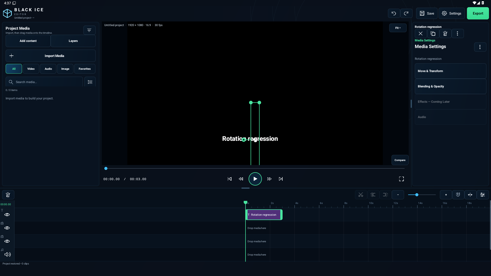
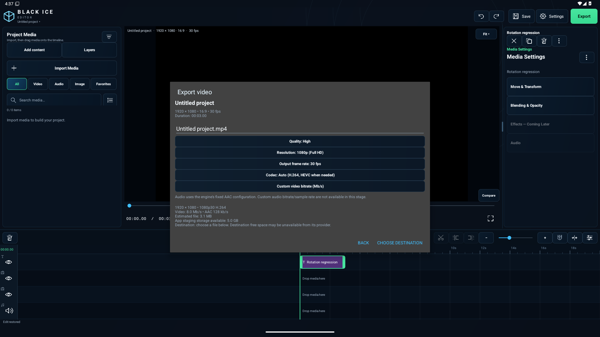
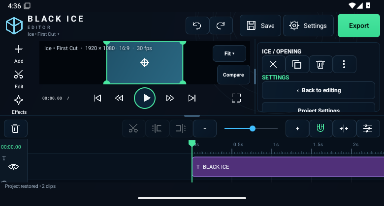

# v1.4.0-dev — landscape stability checkpoint

Development upgrade, based on main 821c363. Automated qualification passed; physical Samsung verification and the explicit limitations below remain outstanding.

## Changes
- Fix transform gesture release after the inspector rebuild detaches its view (rotation dial, position pad, value ruler).
- Decoder orientation is explicitly zeroed after reading source metadata. The ICE Lite compositor alone applies source rotation; user rotation remains a separate project transform. Invalid dimensions fail before decoder allocation.
- Reset Rotation clears only rotation and its animation. Existing undo/project serialization remains in use.
- Persistent bounded private crash/error reports, operation context, OS/device/build/memory and previous process crash/native/ANR exit metadata. Fatal errors are forwarded to Android's original handler. Exception messages are omitted to prevent media/path leakage. Settings → Diagnostics → Crash Logs offers view/copy/share/clear/export. Native tombstone bodies are not collected.
- Wide header removes six tabs; retains save, undo/redo/settings/export. Add content and Layers remain in the media browser. Media Settings replaces Inspector/Project tabs, with Transform, Blending, Effects Coming Later, Audio. Text/shape-specific editing remains in overflow.
- Wide thumbnail horizontal touch drag or mouse drag starts after movement slop, no hold. Vertical touch motion remains browser scrolling. Click retains media actions.
- Wide Split/Trim Start/Trim End beside zoom; enabled state follows playhead. Playback Speed is in overflow. Centered playhead is unchanged.
- Existing built-in effects are bypassed on private render snapshots for preview/export; their saved values remain intact. Engine implementations/tests retained for future recovery. Transitions, transforms, chroma, opacity remain active.
- Native export form: real filename, project details, estimated output size and staging free bytes; quality presets map to actual video bitrates; independent export FPS/resolution/codec and custom bitrate. Existing encoder routing/cancellation/output publication remains.

## Explicit gaps before final acceptance
- Physical Samsung crash reproduction and real Android camera/screen-recording/third-party orientation fixtures remain unverified.
- Destination-provider free capacity is unavailable before selecting a URI; shown as unknown, not fabricated.
- Audio encoder bitrate/sample-rate controls are still fixed, not exposed as fake adjustable options.
- Export progress now shows stage, percentage, elapsed time, output bytes and approximate ETA after sufficient progress, plus cancel/play/share. Provider-specific Open Location remains unavailable.
- Arbitrary canvas/background/save-location choices and new perspective editing are not implemented.
- Retained Preview signing backup recovered privately; certificate matches the existing app. Normal upgrade signing is available; no signing material is published.

## Validation
Added transform-release/undo/save regression, diagnostics privacy check, saved-effect preservation and bitrate tests. Added 0/90/180/270° metadata fixtures with live preview + export marker-pixel comparisons against Android decoding, and four independent export decode checks. The existing engine/export suites passed in the final qualification run.

### Initial candidate evidence (not qualified)

- Initial candidate source: `5b309d4d1c2a23333b8efe7da86ef4d5f1f58417`.
- GitHub Actions run: https://github.com/uran39281-bit/bc-1/actions/runs/39539371367
- Build, lint and **139 JVM tests** passed (0 failures / 0 ignored).
- Test APK manifest independently read: `com.blackice.bc1.icelite`, `1.4.0-dev-icelite`, versionCode **27**.
- APK signature verified with Android apksig. It uses the CI test certificate, not the retained Preview certificate; not an upgrade for `com.blackice.bc1.preview` and may not upgrade older CI test installs. Preserve/backup existing projects before changing installations.
- APK SHA-256: `4290618c673229058e11c353d38bbe6a8e5ac744fa3f5afa3d995195484482d1`.
- Immutable test artifact commit: `fde3041952267e9bf5d039a6bd4e97e2b1cdbbc3`.

Initial Android run: 43/46 passed. Rotation gesture/undo/reopen and all four source orientation preview/export checks passed. Two old UI tests expected removed controls; updated to the new interface. Paused scrub texture pixels passed but the immediate screen capture failed: screen presentation now has its own bounded pixel wait and failure screenshot. Independent host export checks were gated by the test failures and did not run. Requalification required.

Second run (`39541348259`, `2764c282`): 44/46 Android tests passed. Paused scrubbing now passed both texture and real-screen pixel checks. Remaining failures: obsolete Effects selection prompt and ambiguous audio test target (clip name versus category). Effects now consistently explains unavailability; category accessibility labels distinguish buttons from clip names. Requalification pending.

Third run (`39543274500`, `36d61599`): 45/46 Android tests passed, including gesture history/save-reopen and paused scrubbing. Remaining real regression: the newly permanent timeline toolbar crowded the preview in a 780×420 wide window. Short wide windows now cap timeline height to a scrollable ruler/track and reduce status padding; the side rail scrolls. All touch controls keep their dimensions. Requalification pending.

## Final qualification — 2026-10-21

- Source: `d3ee8b4498de6a6fabcfc37f6ffe02a3fcb84ac5`.
- [GitHub Actions run 39544615852](https://github.com/uran39281-bit/bc-1/actions/runs/39544615852): build and lint passed; **139 JVM tests, 46 Android tests, 14 independent export checks passed**.
- Coverage includes rotation gesture release, undo/redo and serialization; 0/90/180/270 source metadata in preview/export; real-screen paused scrubbing; phone and DeX gesture history/save-reopen; compact 780×420 wide layout; layered playback; H.264/AAC, 1080p, 60 fps, HEVC, staged export and vector-only export.
- Earlier failures and corrections are recorded above, not hidden by the final passing run.
- APK: `com.blackice.bc1.preview`, version `1.4.0-dev`, versionCode **27**. Signed with the retained Preview certificate. Install over the existing Preview app without uninstalling it; the separate ICE Lite test app has a different package.
- Certificate SHA-256: `3c578586198b9ebadd9496d38e25851ec0e90d918684dc4994e03d1d7f29a29d`.
- APK SHA-256: `3d21cb73672152c5d391c0298ee53382291b6ce6277891cf330fe1eb95ab399c`.
- Signed APK's non-signature ZIP payload matches CI artifact **12320882151** byte-for-byte. Signature verified with Android apksig. No signing material regenerated or published.
- Private fatal-crash forwarding and previous native/ANR exit collection are implemented but actual process-kill/restart/native-ANR behavior has not been tested on a physical device. The automated diagnostics check verifies stored report content/privacy.
- Immediate media-browser dragging is implemented via movement slop and existing drop handling; a dedicated physical touchscreen/DeX mouse acceptance pass is still required.

## Screenshots

Actual emulator captures, not mockups. The short-wide preview remains fitted and the tool rail/timeline scroll. Screenshots illustrate UI states; they are not a frame-latency measurement.





## Build

Use JDK 17, Gradle 8.11.1 and Android SDK 36. From `BC-1/` run:

```sh
gradle --no-daemon -Pbc1SideBySide testDebugUnitTest lintDebug assembleDebug
```

Run `.github/scripts/bc1-device-checks.sh` with an Android emulator/device and ffmpeg installed for instrumentation and independent export checks. Ordinary local debug signing will not update the retained-key Preview installation. Use the published APK; never commit signing material.
