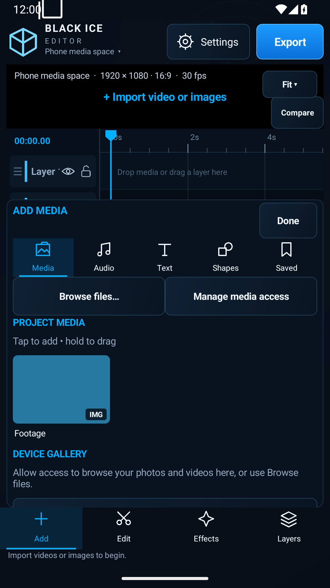
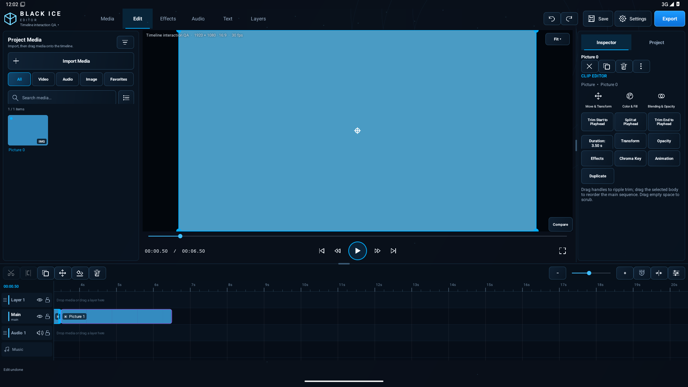

# BC-1 v1.1.2 — preview scrubbing recovery

Qualified source: `c986f55cd257267fc2ec0af6ac363fc0c0232cc4`.
[GitHub Actions 39178553717](https://github.com/uran39281-bit/bc-1/actions/runs/39178553717), completed October 19, 2026 UTC (October 18, America/Phoenix). Both jobs passed.

- 88 JVM tests, zero failures/skips.
- Lint: zero errors, 44 warnings.
- 28 Android tests passed, including the unchanged fast-scrub regression and corrected version-aware diagnostics test. Existing phone/desktop, media insertion, project reopen, timeline, GPU and export tests passed.
- Five independent ffmpeg/ffprobe checks passed: three repeated H.264 1920x1080/AAC exports, missing-media recovery export, and synchronized five-second speed export.
- Final scrub target was 2029 ms; the player reached READY at 2029 ms. This run did not trigger watchdog recovery, so it does not establish how often silent stalls occur or fully exercise that recovery path.
- Phone media-browser and 1920x1080 desktop screenshots reviewed; this patch does not redesign the workspace. Existing compact timeline labels and panel scrolling remain.

## Changes

Retains the single-input live video graph and removal of live frame dropping from the upstream scrub fix. Adds bounded recovery when a seek silently stays buffering for three seconds, including the final seek after touch stops. Recovery rebuilds at the latest timeline target instead of submitting more seeks to the stuck player. Player-error and stall recovery share a maximum of three rebuilds per 30 seconds. Pending watchdogs are canceled when releasing the preview. No test timeouts were increased and no assertions were removed. Export diagnostics now checks the actual installed version. Export graph, package identity and project serialization are unchanged.

## APK

`com.blackice.bc1.preview`, version 1.1.2, versionCode 20. Signed with the retained preview certificate, SHA-256 `3c578586198b9ebadd9496d38e25851ec0e90d918684dc4994e03d1d7f29a29d`. Signature verified; non-signature ZIP contents match the CI APK exactly. See SHA256SUMS.txt. Install over the existing Preview; do not uninstall first. Older APKs are preserved.

## Limitations

Development preview, not production-stable certification. The underlying Media3 silent-buffering cause and historical intermittent export watchdog stall are not claimed fixed. Physical Snapdragon 8 Gen 3/Samsung DeX testing and performance measurements remain outstanding. Prior V1.1 feature limitations remain; no Page Curl was introduced.

